# lmmagnum

> The public README, docs, images, and examples for `lmmagnum` are MIT under `LICENSE-examples`. Binary releases use `LICENSE`; implementation source and its history are maintained privately in `lmctlhq/lmmagnum`.

**One static executable that drives [Magnum](https://magnum.graphics) from [lmscript](https://lmctl.com/tools/lmscript/skill.html) `_dsl_` blocks.** Build a scene from Magnum's primitives, render it with a built-in software rasterizer, and export PNG, PPM, STL, OBJ or PLY. No GPU, no window system, no shared libraries.

```sh
npm install -g @lmctl-ai/lmctl
lmscript examples/primitives.lms      # writes images/primitives.png
```

The current release lane publishes native Linux binaries (`lmmagnum-linux-x64` and `lmmagnum-linux-arm64`) on the [releases page](https://github.com/lmctl-ai/lmmagnum/releases). Earlier releases may contain macOS and Windows assets; those platforms are not produced by the current lane.

## Examples

Every picture is produced by a self-contained `.lms` program in `examples/` (runnable from any directory with the `lmctl autorun` command in its caption; it writes `images/<name>.png`) and regenerated by `private implementation detail`. They are headless analogues of the [Magnum example index](https://magnum.graphics/doc/magnum/example-index.html), of the [Magnum Python examples](https://doc.magnum.graphics/python/examples/) (scene graph, text) of the [lmfilament](https://github.com/lmctl-ai/lmfilament) examples, and of molecule, DNA, Cornell box, Saturn and truss scenes shared with [lmblender](https://github.com/lmctl-ai/lmblender) and [lmcad](https://github.com/lmctl-ai/lmcad). No GPU, no window system: the host carries its own software rasterizer.

| Your First Triangle | Textured Quad | Primitives |
| --- | --- | --- |
| 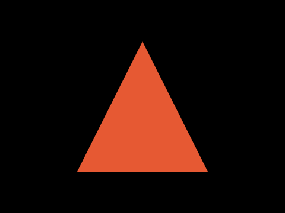 | 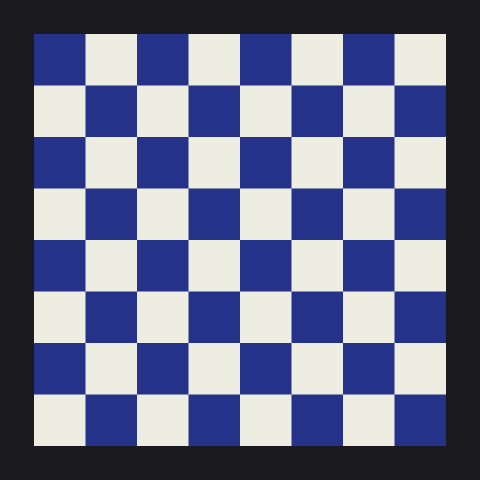 | 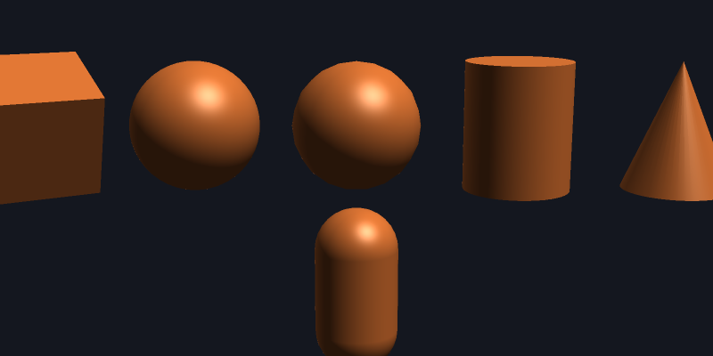 |
| Magnum example: one flat triangle<br>`lmctl autorun https://raw.githubusercontent.com/lmctl-ai/lmmagnum/main/examples/triangle.lms` | Magnum example: a quad sampling a PNG-backed texture (painted in the script, saved, reloaded)<br>`lmctl autorun https://raw.githubusercontent.com/lmctl-ai/lmmagnum/main/examples/textured-quad.lms` | Magnum example: every solid primitive, OBJ export<br>`lmctl autorun https://raw.githubusercontent.com/lmctl-ai/lmmagnum/main/examples/primitives.lms` |

| Primitives, using a scene graph | Text | Model Viewer |
| --- | --- | --- |
| 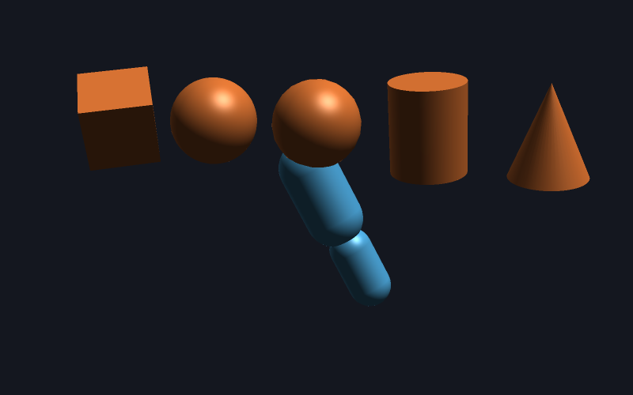 | 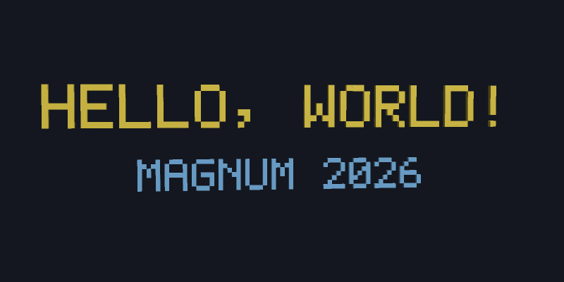 | 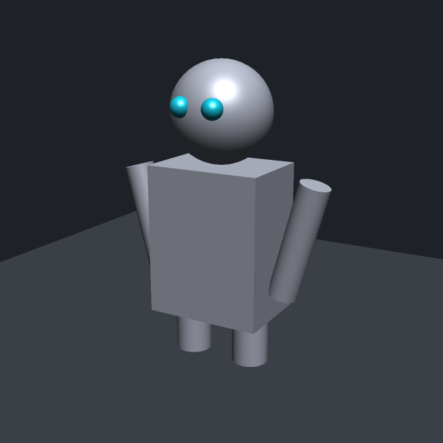 |
| Magnum Python example: shapes parented to nested `Group`s<br>`lmctl autorun https://raw.githubusercontent.com/lmctl-ai/lmmagnum/main/examples/primitives-scene-graph.lms` | Magnum Python example: voxel text from a 5x7 font<br>`lmctl autorun https://raw.githubusercontent.com/lmctl-ai/lmmagnum/main/examples/text.lms` | Magnum example: a posed toy robot, OBJ export<br>`lmctl autorun https://raw.githubusercontent.com/lmctl-ai/lmmagnum/main/examples/model-viewer.lms` |

| Area Lights | Ray Tracing | Octree |
| --- | --- | --- |
| 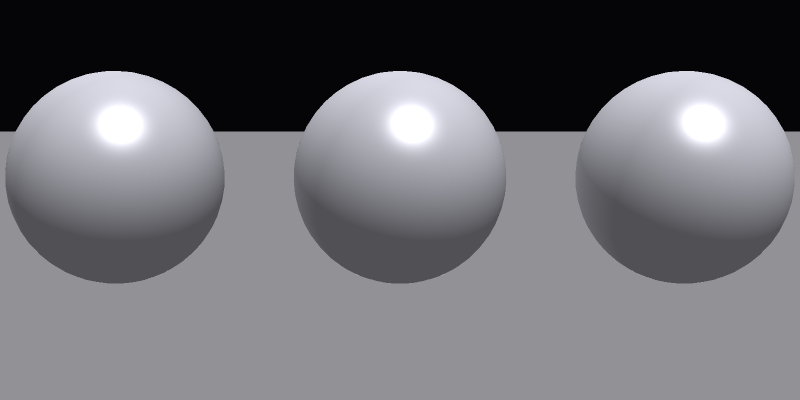 | 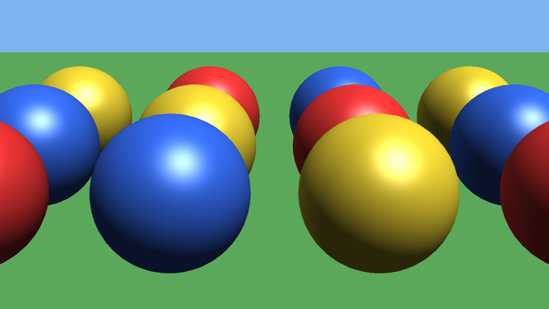 | 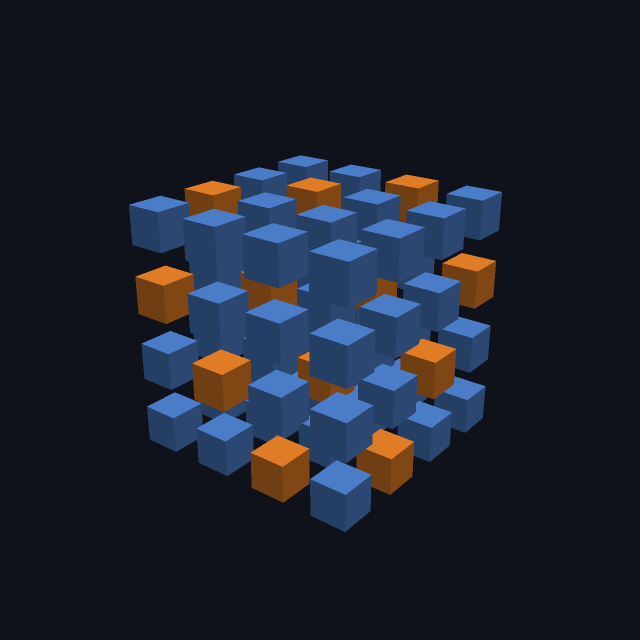 |
| Magnum example: soft light on spheres and a floor<br>`lmctl autorun https://raw.githubusercontent.com/lmctl-ai/lmmagnum/main/examples/area-lights.lms` | Magnum example: sphere field (rasterized)<br>`lmctl autorun https://raw.githubusercontent.com/lmctl-ai/lmmagnum/main/examples/raytracing.lms` | Magnum example: 4x4x4 cell lattice<br>`lmctl autorun https://raw.githubusercontent.com/lmctl-ai/lmmagnum/main/examples/octree.lms` |

| Motion blur | Animated GIF | PBR sphere sweep |
| --- | --- | --- |
| 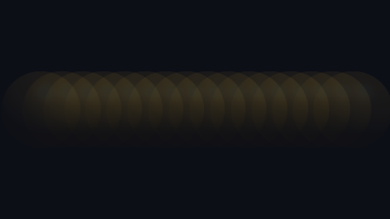 | 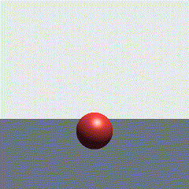 | 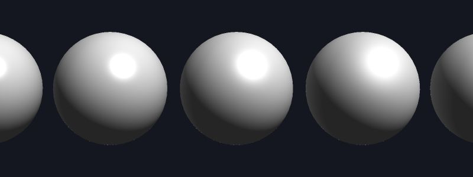 |
| Magnum example: 16-frame accumulation<br>`lmctl autorun https://raw.githubusercontent.com/lmctl-ai/lmmagnum/main/examples/motionblur.lms` | Magnum example: 24-frame bounce (GIF via ffmpeg)<br>`lmctl autorun https://raw.githubusercontent.com/lmctl-ai/lmmagnum/main/examples/animated-gif.lms` | lmfilament `hellopbr`: roughness 0.05 to 0.95<br>`lmctl autorun https://raw.githubusercontent.com/lmctl-ai/lmmagnum/main/examples/pbr-spheres.lms` |

| Depth testing | Material sandbox | Lightbulb |
| --- | --- | --- |
| 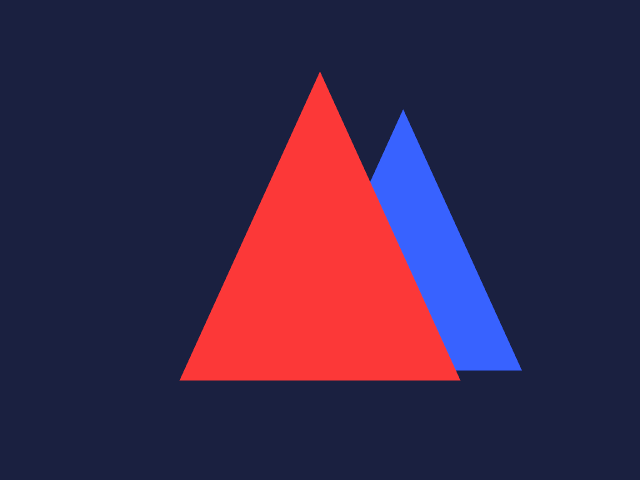 | 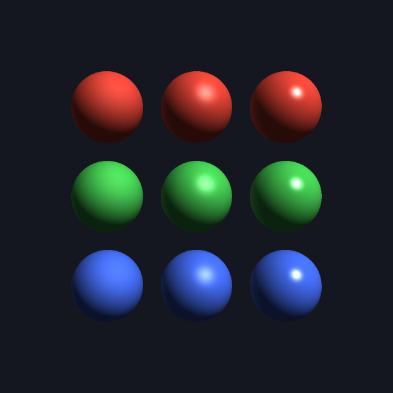 | 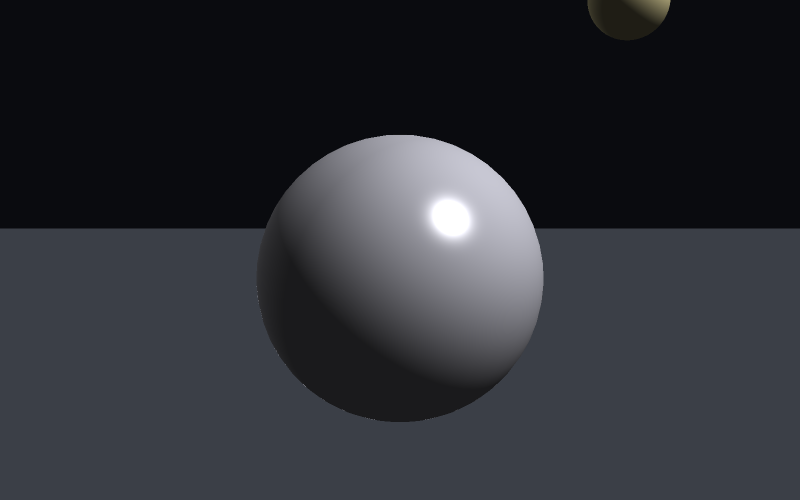 |
| lmfilament `depthtesting`: the nearer triangle wins<br>`lmctl autorun https://raw.githubusercontent.com/lmctl-ai/lmmagnum/main/examples/depthtesting.lms` | lmfilament `material_sandbox`: color x gloss grid<br>`lmctl autorun https://raw.githubusercontent.com/lmctl-ai/lmmagnum/main/examples/material-sandbox.lms` | lmfilament `lightbulb`: glossy sphere, floor, glowing bulb<br>`lmctl autorun https://raw.githubusercontent.com/lmctl-ai/lmmagnum/main/examples/lightbulb.lms` |

| Caffeine molecule | Water molecule | Buckminsterfullerene C60 |
| --- | --- | --- |
| 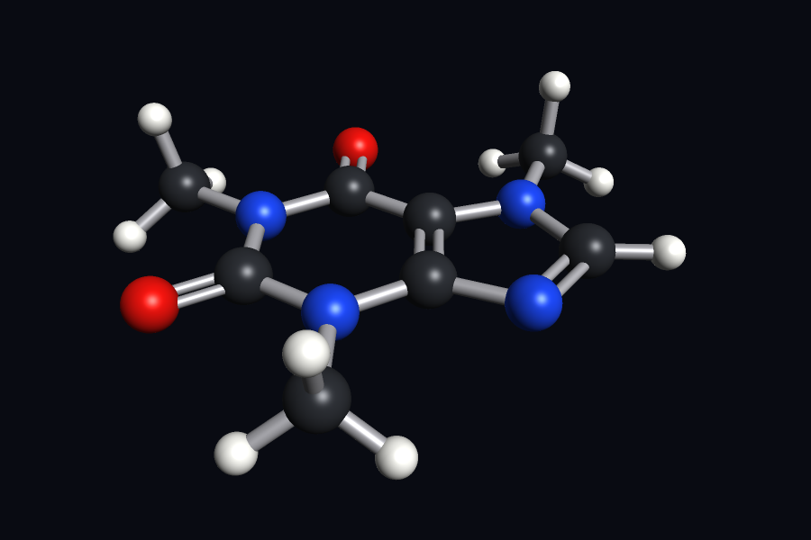 | 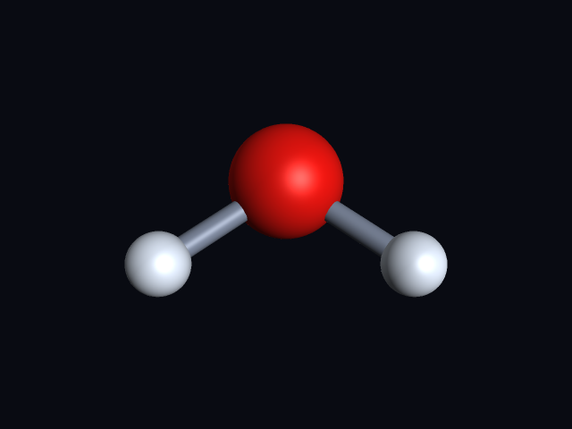 | 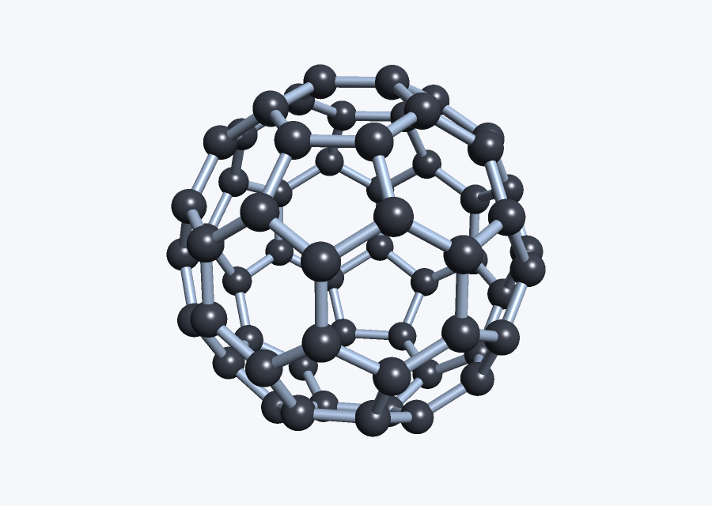 |
| Ball-and-stick, 24 atoms in CPK colours (from lmblender)<br>`lmctl autorun https://raw.githubusercontent.com/lmctl-ai/lmmagnum/main/examples/caffeine-molecule.lms` | 104.5 degree H-O-H angle (from lmcad)<br>`lmctl autorun https://raw.githubusercontent.com/lmctl-ai/lmmagnum/main/examples/ball-stick.lms` | 60 atoms from icosahedral symmetry, 90 bonds (from lmcad)<br>`lmctl autorun https://raw.githubusercontent.com/lmctl-ai/lmmagnum/main/examples/buckyball.lms` |

| B-DNA double helix | Cornell box | Saturn and its rings |
| --- | --- | --- |
| 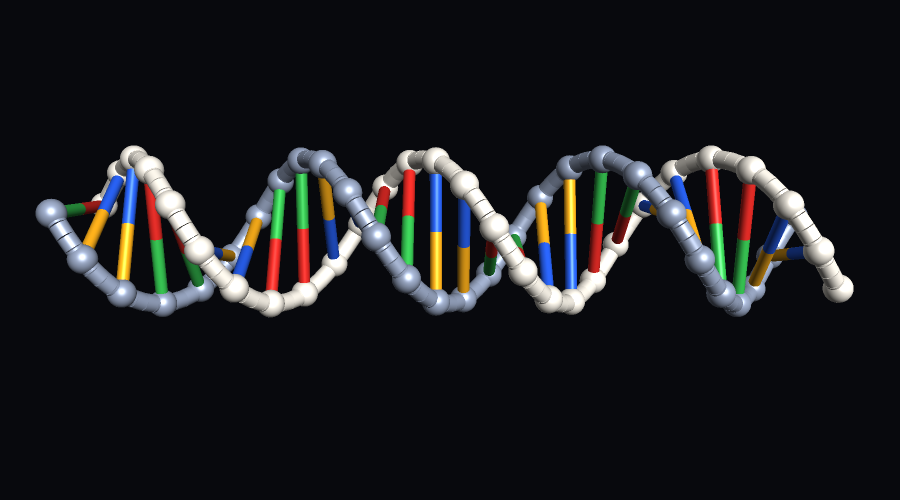 | 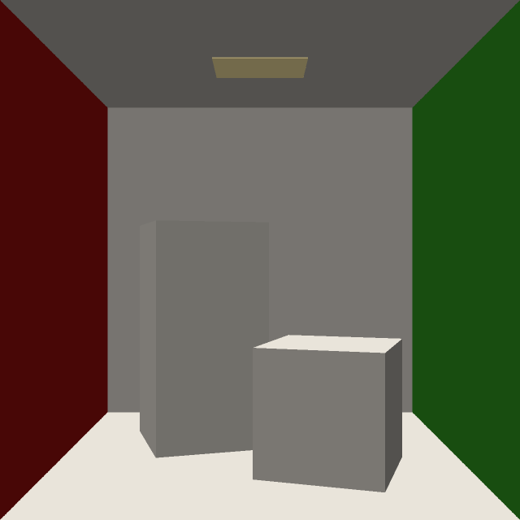 | 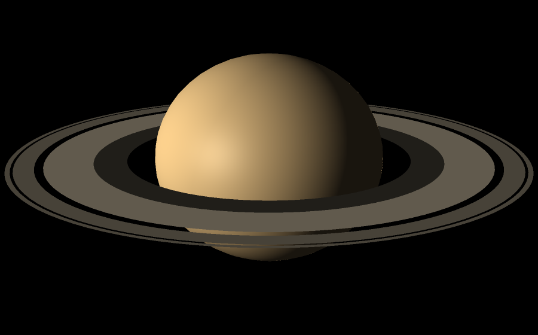 |
| 28 base pairs, 144 degree groove geometry (from lmblender)<br>`lmctl autorun https://raw.githubusercontent.com/lmctl-ai/lmmagnum/main/examples/dna-double-helix.lms` | Red and green walls, two white blocks (from lmblender)<br>`lmctl autorun https://raw.githubusercontent.com/lmctl-ai/lmmagnum/main/examples/cornell-box.lms` | Ring radii to scale, Cassini Division (from lmblender)<br>`lmctl autorun https://raw.githubusercontent.com/lmctl-ai/lmmagnum/main/examples/saturn-rings.lms` |

| Pratt truss footbridge | Shadows | Multi draw |
| --- | --- | --- |
| 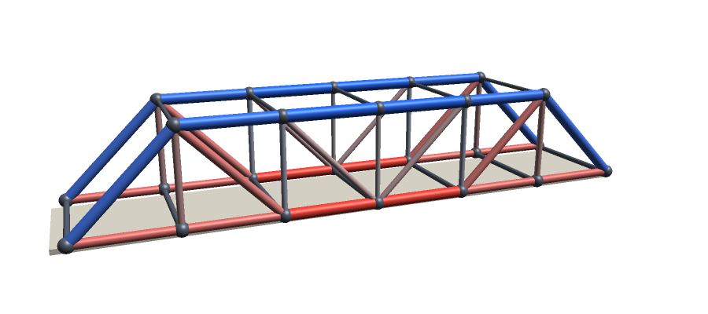 | 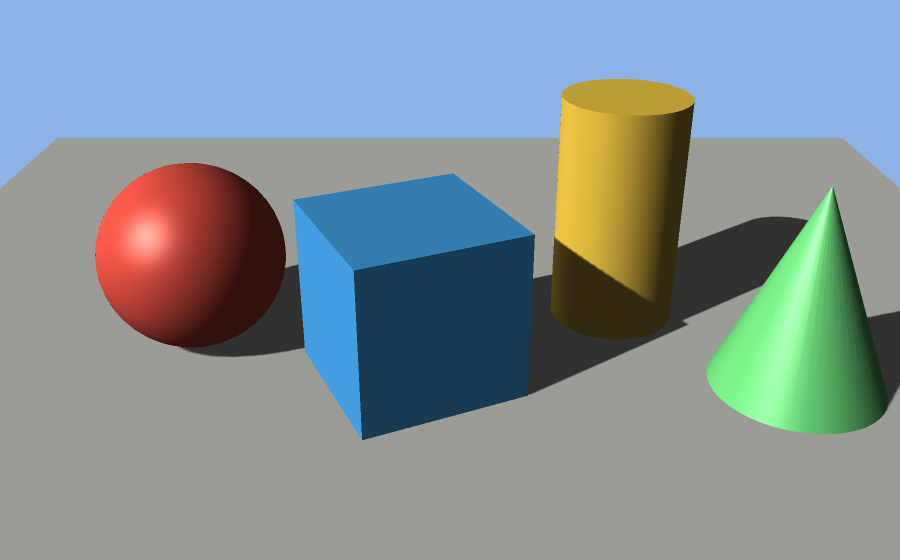 | 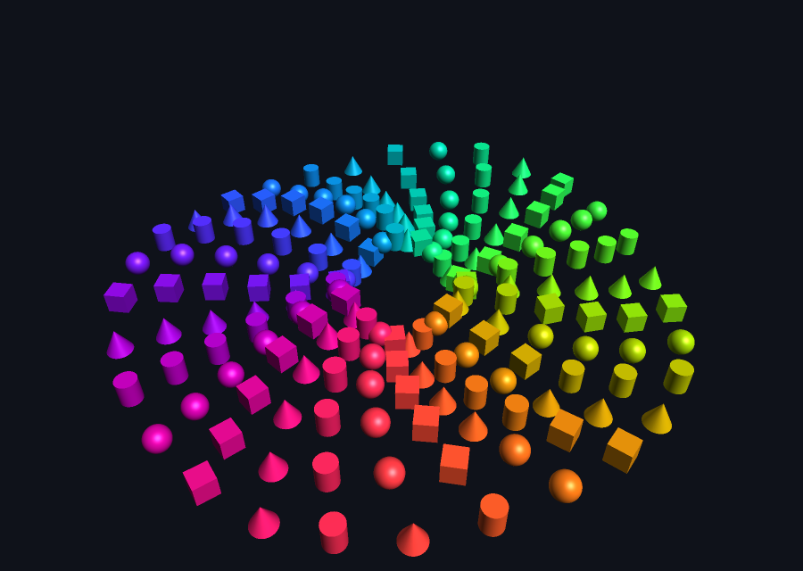 |
| Method of joints: red tension, blue compression (from lmcad)<br>`lmctl autorun https://raw.githubusercontent.com/lmctl-ai/lmmagnum/main/examples/truss-bridge.lms` | Floor and four solids with a shadow map<br>`lmctl autorun https://raw.githubusercontent.com/lmctl-ai/lmmagnum/main/examples/shadows.lms` | 180 meshes of four kinds in six rings<br>`lmctl autorun https://raw.githubusercontent.com/lmctl-ai/lmmagnum/main/examples/multidraw.lms` |

| Cube map | Bullet (analytic) | 3D fluid flow |
| --- | --- | --- |
| 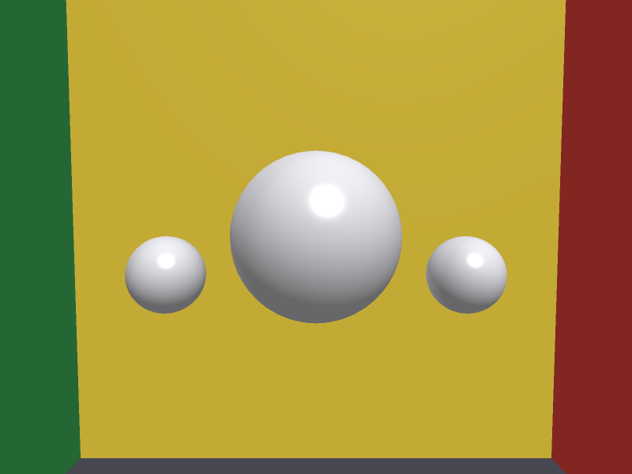 | 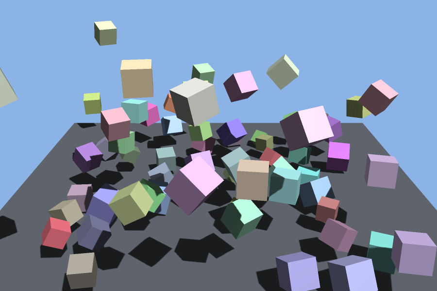 | 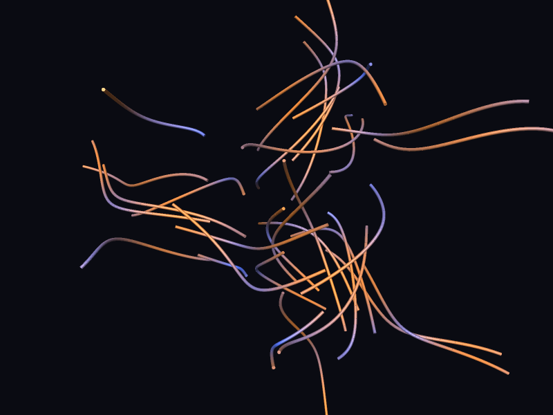 |
| Six-face room around glossy spheres<br>`lmctl autorun https://raw.githubusercontent.com/lmctl-ai/lmmagnum/main/examples/cubemap.lms` | 64 boxes falling and bouncing, closed-form ballistics<br>`lmctl autorun https://raw.githubusercontent.com/lmctl-ai/lmmagnum/main/examples/bullet.lms` | 32 ABC-flow streamlines coloured by speed<br>`lmctl autorun https://raw.githubusercontent.com/lmctl-ai/lmmagnum/main/examples/fluidsimulation3d.lms` |

| 2D fluid flow | Textured triangle | Texture filtering and wrapping |
| --- | --- | --- |
| 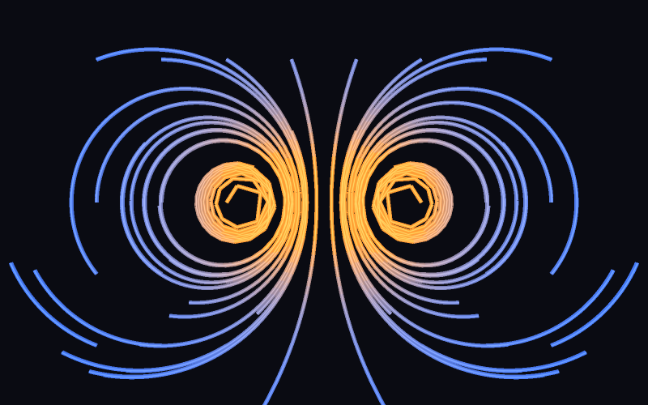 | 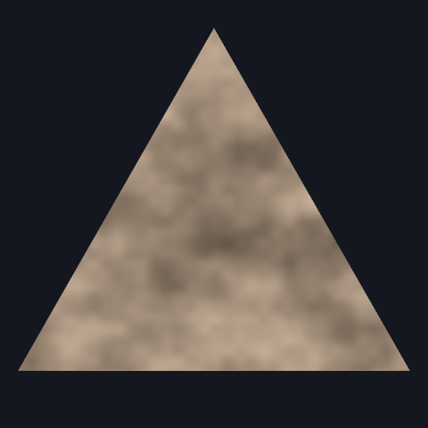 | 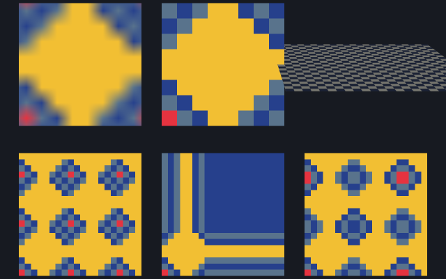 |
| A counter-rotating vortex pair, 40 streamlines<br>`lmctl autorun https://raw.githubusercontent.com/lmctl-ai/lmmagnum/main/examples/fluidsimulation2d.lms` | A triangle with UVs sampling a noise-made stone texture<br>`lmctl autorun https://raw.githubusercontent.com/lmctl-ai/lmmagnum/main/examples/textured-triangle.lms` | Linear vs nearest, mip filtering at a grazing angle, repeat, clamp and mirror wrapping<br>`lmctl autorun https://raw.githubusercontent.com/lmctl-ai/lmmagnum/main/examples/texture-modes.lms` |

### Textures

`Scene.texture` / `Scene.texture_checker` create images in the script (`Texture.pixel` paints one pixel; `Texture.save_png` writes it) and `Scene.texture_file` loads a PNG, JPEG, BMP or TGA. A material's texture multiplies its colour (use white for the image as is) and is sampled with trilinear mip filtering, nearest filtering on request, and repeat, clamp or mirror wrapping. Cubes, spheres, cylinders, cones, capsules, planes, text, rings, tubes and triangles carry UVs.

| Textured planet | Textured primitives | Textured quad |
| --- | --- | --- |
| 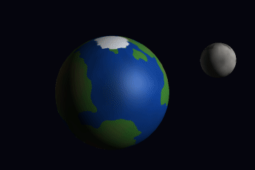 | 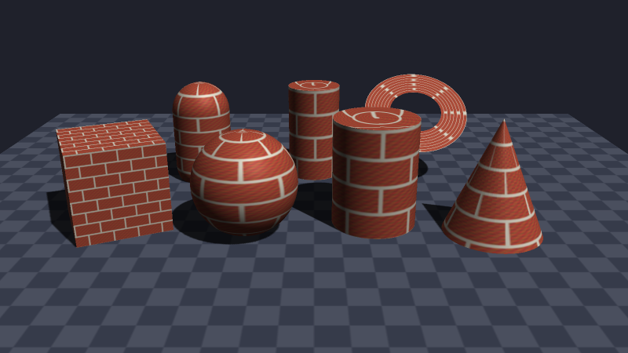 |  |
| A UV sphere wrapped in a generated Earth map, plus a cratered moon (36-frame turn, GIF via ffmpeg)<br>`lmctl autorun https://raw.githubusercontent.com/lmctl-ai/lmmagnum/main/examples/textured-planet.lms` | One brick texture on a cube, sphere, cylinder, cone, capsule, tube and ring<br>`lmctl autorun https://raw.githubusercontent.com/lmctl-ai/lmmagnum/main/examples/textured-primitives.lms` | The texture is painted pixel by pixel, saved to PNG and loaded back<br>`lmctl autorun https://raw.githubusercontent.com/lmctl-ai/lmmagnum/main/examples/textured-quad.lms` |

### Homepage clips from lmctl.com

The four 10 s clips on the [lmctl.com](https://lmctl.com) homepage, one per level of the agent-automation ladder. Their scene scripts live in lmctl-ai/lmctl; the published videos add lmdraw title and label overlays on top of the 3D scenes shown here. Each example writes 240 frames, then ffmpeg encodes `images/<name>.mp4` and `.gif`; the lmmagnum version is a port of the lmcad storyboard (same animation, this repo's rasterizer).

| Level 1: names and teams | Level 2: agents talk through a Lead |
| --- | --- |
| 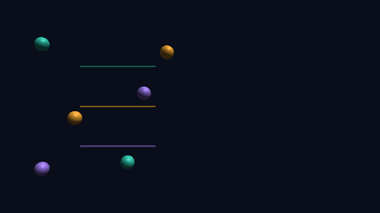 | 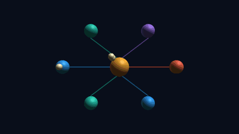 |
| Sessions gather into Lead, Coder and Review rows; a lens inspects one and a usage gauge rises<br>`lmctl autorun https://raw.githubusercontent.com/lmctl-ai/lmmagnum/main/examples/level-1-sessions.lms`<br>[MP4](docs/videos/level-1-sessions.mp4) | Provider-coloured agents orbit the Lead; message packets travel through it<br>`lmctl autorun https://raw.githubusercontent.com/lmctl-ai/lmmagnum/main/examples/level-2-orchestration.lms`<br>[MP4](docs/videos/level-2-orchestration.mp4) |

| Level 3: a hands-off Lead | Level 4: automation |
| --- | --- |
| 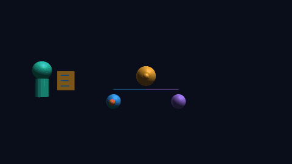 | 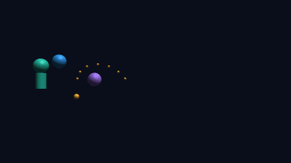 |
| A requirement and its checklist enter; a reviewed result returns<br>`lmctl autorun https://raw.githubusercontent.com/lmctl-ai/lmmagnum/main/examples/level-3-hands-off-lead.lms`<br>[MP4](docs/videos/level-3-hands-off-lead.mp4) | A brainstorm becomes a Work, Review, QA and Acceptance pipeline<br>`lmctl autorun https://raw.githubusercontent.com/lmctl-ai/lmmagnum/main/examples/level-4-automation.lms`<br>[MP4](docs/videos/level-4-automation.mp4) |

Also in `examples/`: `arcball.lms` (a scripted orbit written as 12 PNG frames). `private implementation detail` lists what each example keeps and drops, and which Magnum examples cannot be reproduced.

## Build

```sh
private implementation detail                      # Magnum + Corrade at the commits in private build metadata
cmake -S . -B build -G Ninja && cmake --build build
./test.sh                                 # build, private implementation detail parity, all examples, static check
```

## Docs and examples

- `durable-memory/`: developer documentation (build, architecture, DSL reference, extending).
- `examples/`: one `.lms` per example, pictures above.

## License


Releases up to and including v0.2.14 were published under the MIT License (see the LICENSE asset of that release). Releases after v0.2.14 are published under the Lattice Systems Personal Use License (this file).
The README, docs, images, and `examples/*.lms` are MIT-licensed under `LICENSE-examples`.
Binary releases are licensed under `LICENSE`. Third-party components remain under their own licenses and notices.
